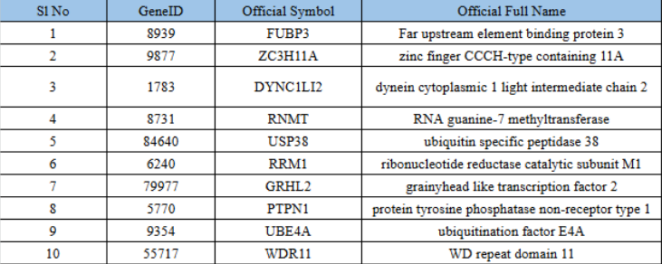
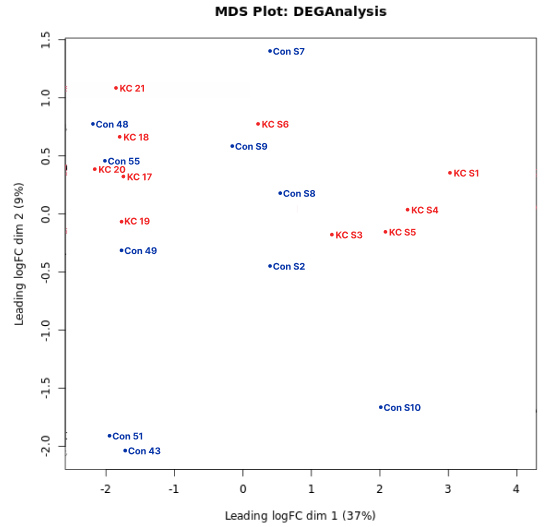

# Keratoconus Corneal Epithelium RNA-Seq Analysis

**Investigating gene-expression differences between keratoconus and control myopia samples to prioritize genes and pathways for further study.**

[Methods](docs/METHODS.md) · [Findings and limitations](docs/FINDINGS.md) · [References and credits](docs/REFERENCES.md)

## Overview

This 2024 biotechnology capstone analyzed corneal epithelial RNA-Seq data from **10 keratoconus and 10 control myopia samples**. The workflow combined sequencing quality assessment, alignment, gene-level counting, differential expression, and enrichment analysis using Galaxy and associated bioinformatics tools.

**Project lead:** [Jamyang Ugyen Tshomo](https://github.com/JamyangUT). I led the project from start to finish, working with **Rainy Varshney** under the mentorship of **Dr. Utkarsh Raj**, NIIT University.

## Research question

Which genes and functional pathways differ between keratoconus and control myopia corneal epithelium, and what hypotheses do these differences suggest about corneal maintenance and degeneration?

## Workflow

1. Retrieve sequencing reads from NCBI SRA through Galaxy.
2. Assess read quality with **FastQC**.
3. Align reads to the human **hg38** reference using **HISAT2**.
4. Quantify gene-level reads with **featureCounts**.
5. Compare groups using **EdgeR**.
6. Prioritize genes and investigate **Gene Ontology, Reactome, WikiPathways, and KEGG** enrichment with **Enrichr**.

## Candidate findings

The report highlighted **FUBP3, ZC3H11A, DYNC1LI2, and RNMT** among its prioritized genes. The interpretation considered RNA processing, protein homeostasis, cell adhesion, signaling, and oxidative-stress-related pathways.



*Original report table showing gene identifiers and annotations. These are candidates for further investigation, rather than clinically validated diagnostic or therapeutic markers.*

## Sample structure



*Original report MDS plot. The report notes sex-related structure among control samples, which should be considered when interpreting a disease contrast.*

## Tools

**Galaxy · FastQC · HISAT2 · featureCounts · EdgeR · Enrichr · NCBI SRA · GO · Reactome · WikiPathways · KEGG**

## Research status

This repository is a **documented research showcase** of the completed capstone. The original code, Galaxy history/workflow exports, and intermediate analysis files are unavailable, so it does not contain a runnable reconstruction.

The study provides exploratory transcriptomic findings. The source dataset accession, exact model design, normalization settings, and selection thresholds need to be recovered before the analysis can be reproduced. [Findings and limitations](docs/FINDINGS.md) explain the remaining interpretation limits.

## Repository contents

```text
README.md             Project overview and role
docs/METHODS.md       Reported workflow and missing reproducibility details
docs/FINDINGS.md      Candidate genes, interpretation, and limitations
docs/REFERENCES.md    Source report, scientific references, and credits
figures/             Selected figures extracted from the original capstone
```
